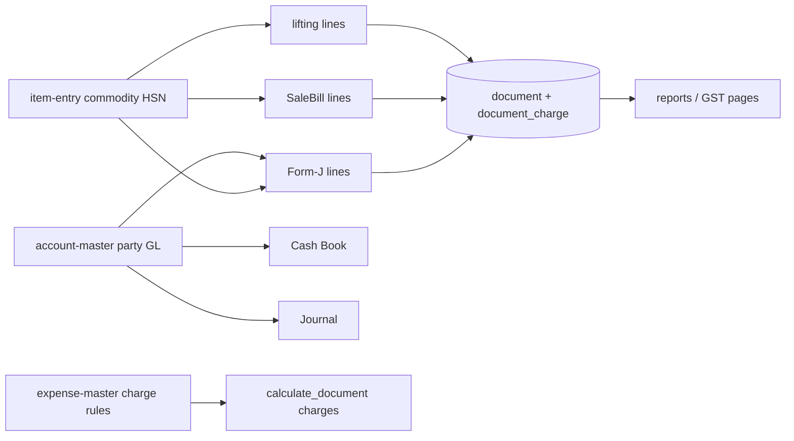

# Phase 1.1 — Mandi monolith audit (`EntryWindowImpl.tsx`)

**Goal:** Catalog grain-trading forms still inside the legacy bundle before extraction. Preserve **keyboard-first / numpad** flow (Enter = Tab, grid Enter = new row, F-keys).

**Router:** `frontend/src/features/legacy/EntryWindowImpl.tsx` → `EntryWindow({ title, onExit })`  
**Shared UX today:** `TransactionScreen` (F12 save, F7 print, Enter flow), `DenseDocumentForm` (config-driven gate/milling/challans), `accounts-entry.css` (split entry screens).

**Phase 1 outputs:** [shared LegacyFormContainer](../../frontend/src/features/shared/) · target folders under `features/*` · this audit.

---

## Extraction status legend

| Status | Meaning |
|--------|---------|
| **Extracted** | Dedicated `features/<name>/` + backend `*_entry.py` |
| **Monolith** | Component function still in `EntryWindowImpl.tsx` |
| **Dense** | Routed via `DenseDocumentForm.tsx` configs (not EntryWindowImpl body) |
| **Scaffold** | Phase 1 folder + `hooks.ts`; logic not moved yet |

---

## Grain / mandi forms catalog

### Already extracted (do not duplicate logic)

| Menu / screen | Feature module | Backend | API pattern |
|---------------|----------------|---------|-------------|
| Kachi Purchase | `features/kachi-purchase/` | `kachi_purchase.py` | `save_kachi_*`, lookups |
| Mandi Purchase Entry | `features/mandi-purchase-entry/` | `mandi_purchase_entry.py` | Mandi fees via calc snapshot |
| Lifting Entry | `features/lifting-entry/` | `lifting_entry.py` | Line party/item/**rate** lookups |
| GST Purchase / Invoice / GST DN-CN / GST expense | respective `features/*` | `gst_*_entry.py` | GST lines + charges |
| Voucher Entry | `features/voucher-entry/` | `voucher_entry.py` | Receipt/Payment/Contra/Journal |

**Keyboard:** Lifting uses **F3 Save / F4 Cancel** + `useGridEnterNavigation`. Mandi/Kachi use `accounts-entry` grid pattern.

---

### Monolith components (still in `EntryWindowImpl.tsx`)

#### `FormJ` — **Extracted** → `features/form-j-entry/`

| Aspect | Detail |
|--------|--------|
| **Props** | `{ onExit(): void }` via `FormJEntryScreen` |
| **Local state** | `farmer`, `number`, `date`, `dueDate`, `rows[]` (`DheriRow`), accounts (`farmerAccount`, `purchaseAccount`, `commodityTransfer`), `gatePassRequired`, `selfPurchase`, `excludedCharges`, `rateOverrides`, `bonus`, `calculation`, `postedId` |
| **Row shape** | `commodity`, `purchaser`, `gpNo`, `bags`, `pack`, `extra`, `rate` |
| **Qty formula** | `formJQuantity`: `(bags×pack + extra kg) / 100` quintals |
| **Payload** | `post_document` / `calculate_document`: `document_type: "form_j"`, `lines[]` with `quantity_scaled`, `rate_paise`, `gate_pass_number`, `purchaser_party_id`; `header`: `due_date`, `gate_pass_required`, `self_purchase`, `commodity_transfer_account_id`; mandi **charges** via `excluded_charge_codes`, `overrides`, `bonus_paise` |
| **Deps** | `Autocomplete` party/commodity/account, `TransactionScreen`, `MandiVoucherActions`, `workflowApi().calculate_document` |
| **Shortcuts** | Ctrl+F toggles self-purchase; grid Enter via `useGridEnterNavigation` |

#### `SaleBill` — **Monolith** → target `features/form-i-debit-entry/` (also Sale Invoice)

| Aspect | Detail |
|--------|--------|
| **Props** | `{ title, onExit }` — `Form - I (Dr.)` → `form_i_debit`, else `sale_invoice` |
| **State** | Header: party, accounts, transport, freight, advance, flags (`stockSale`, `multiTax`, …); grid `SaleBillRow`: commodity, commission agent, source #, bags, pack, extra, rate |
| **Qty** | `saleBillQuantity(row)` same pack/bags/extra pattern as Form-J |
| **Payload** | `document_type`, `lines[]`, `header` freight/GR/e-way; charge exclusions/overrides |
| **Enter flow** | `useFormEnterFlow(formRef)`, `useFieldFocusHandlers` |

#### `FormICredit` — **Monolith** → target `features/form-i-credit-entry/`

| Aspect | Detail |
|--------|--------|
| **Props** | `{ onExit }` |
| **State** | Party, Form-I number, purchase account, commodity lines (credit purchase pattern) |
| **Payload** | `document_type: "form_i_credit"` via `post_document` |

#### `CashBookForm` — **Monolith** → target `features/cash-book-entry/`

| Aspect | Detail |
|--------|--------|
| **Props** | `{ onExit }` |
| **State** | `number`, `date`, `cashAccount`, `receipts[]`, `payments[]`, `cashInHand` |
| **Row** | `CashEntryRow`: account, amount, remarks |
| **Payload** | `post_voucher` (receipt/payment columns), cash-in-hand preview RPC |

#### `JournalForm` — **Monolith** → target `features/journal-entry/`

| Aspect | Detail |
|--------|--------|
| **Props** | `{ kind, onExit }` — `Journal` \| `Accounting Voucher` |
| **State** | Voucher grid `VoucherEntryRow`: Dr/Cr, account, amounts, remarks; credit limit modal |
| **Payload** | `post_voucher` with balanced lines |
| **Note** | Separate from `features/voucher-entry/` (Receipt/Payment/Contra/Journal UI for daily voucher menu) |

#### `DocumentForm` — **Monolith** (generic)

| Aspect | Detail |
|--------|--------|
| **Props** | `{ title, onExit }` |
| **State** | Simple single-line commodity posting for legacy register types |
| **Payload** | `post_document` with `documentTypes[title]` |

#### `documentTypes` map (router fallback)

| Screen title | `document_type` | Target module (Phase 2+) |
|--------------|-----------------|---------------------------|
| Form - J | `form_j` | `form-j-entry` (duplicate route — FormJ takes precedence) |
| Form - I (Dr.) | `form_i_debit` | `form-i-debit-entry` |
| Form - I (Cr.) | `form_i_credit` | `form-i-credit-entry` |
| Transfer Challan | `transfer_challan` | `transfer-challan-entry` (Dense) |
| Sale / Purchase Invoice | `sale_invoice` / `purchase_invoice` | invoice / dense |
| Delivery Challan | `delivery_challan` | dense / future feature |
| Gate Pass | `gate_pass` | `gate-pass-entry` |
| Sale / Purchase Memo | memos | dense |
| Inward / Outward | inward / outward | `gate-pass-entry` |
| Consignment Dr/Cr | consignment_* | future |
| Milling Inward/Outward | milling_* | future |
| Packing Material Transfer | packing_material_transfer | dense |

---

### Dense document forms (`DenseDocumentForm.tsx`)

Routed when `supportsDenseDocument(screen)` — **not** inside EntryWindowImpl source, but same daily menu family.

| Config key | document_type | Mandi / grain notes |
|------------|---------------|---------------------|
| **Inward** / **Outward** / **Gate Pass** | inward / outward / gate_pass | **Weighbridge slip** header field; gross/tare/moisture columns; qty = net weight |
| Transfer Challan | transfer_challan | Stock movement |
| Delivery Challan | delivery_challan | Logistics |
| Milling Inward / Outward | milling_* | Processing yield |
| Consignment (Dr./Cr.) | consignment_* | Agent stock |
| Purchase/Sale Memo, Purchase Invoice | various | Trade docs |
| Kachi / Mandi / GST / Lifting | * | **Dual route:** dense config exists but menu uses **extracted screens** |

**API:** `calculate_document`, `post_document`, `search_documents`, `get_document`, print/WhatsApp hooks.

---

## Cross-form dependencies (masters → entry → reports)

---

## Mandi fee / charge touchpoints

| Mechanism | Where set | Stored |
|-----------|-----------|--------|
| Effective-dated charge rules | Expense master, party/commodity rules | `document_charge` on post |
| Live preview | `calculate_document` | Response `calculation.charges` |
| Exclude fee | UI checkbox lists | `excluded_charge_codes[]` in payload |
| Rate override | Mandi sidebar / Form-J | `overrides` + audit reason |
| TCS/TDS/APMC | `calculations/mandi.py` | Snapshot on document |

---

## Phase 2 migration order (recommended)

1. **Form-J** (highest daily use, monolith weight)  
2. **Cash Book** + **JournalForm** (voucher API shared with voucher-entry patterns)  
3. **SaleBill / Form-I Cr.**  
4. Wire **Dense** inward/outward/gate pass into `gate-pass-entry` wrapper using `LegacyFormContainer`  
5. Delete moved functions from `EntryWindowImpl.tsx`; router imports feature screens only  

---

## Related docs

- [visual-system-map.md](./visual-system-map.md)  
- [CODEMAP.md](./CODEMAP.md)  
- [MODULE_LAYOUT.md](./MODULE_LAYOUT.md)  
- [implementation-progress.md](../implementation-progress.md)  
