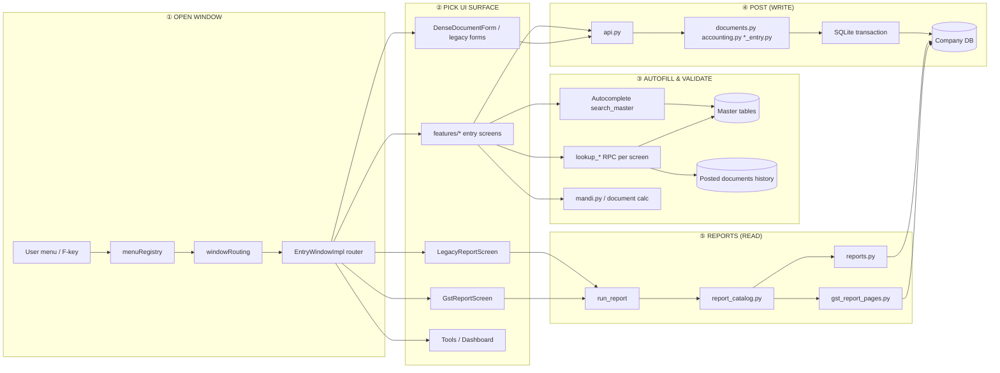
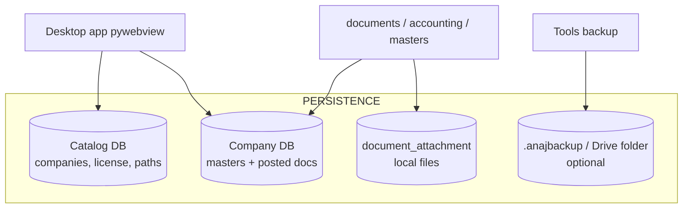
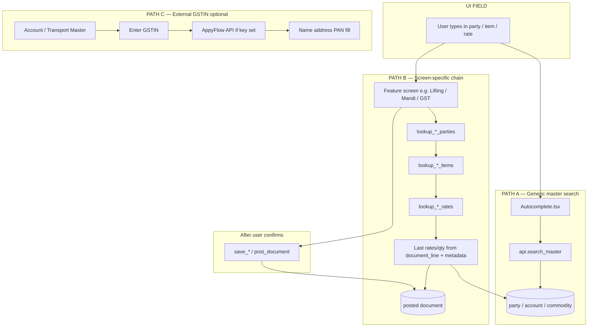
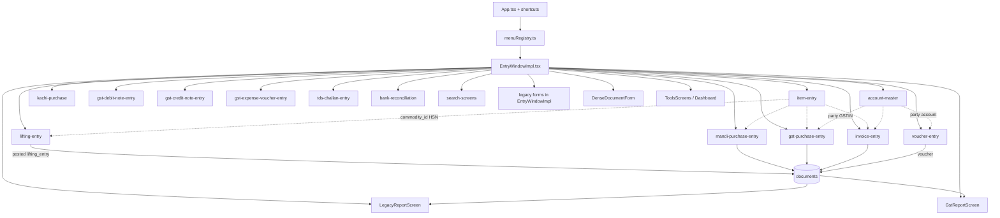
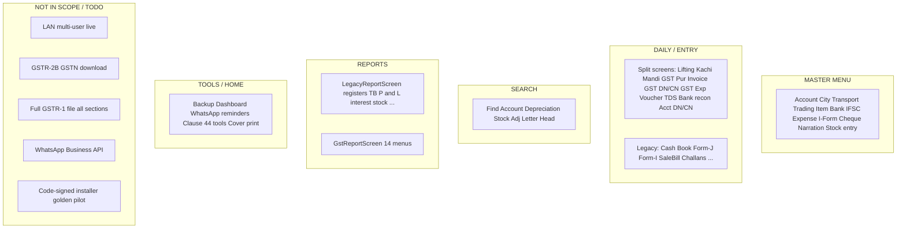
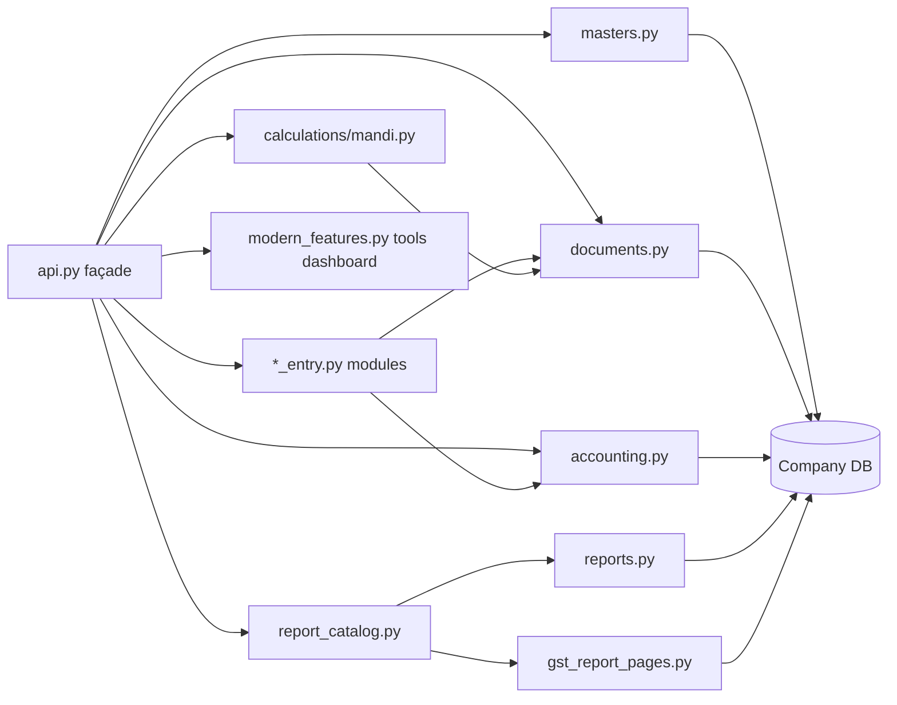
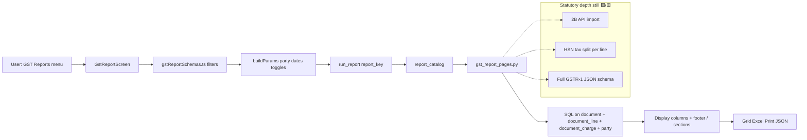

# Anaj ERP — Visual system map (lifecycle & dependencies)

Box-style architecture similar to an **incident/resolution lifecycle**: numbered steps left → right, **data stores** at the bottom, **UI zones** grouped, and **status colours** on every major block.

**How to view:** Open this file in Cursor / GitHub / any Mermaid preview. Colours use `classDef` (green / yellow / red).

**Companion doc:** [project-status-and-architecture.md](../project-status-and-architecture.md)

---

## Legend

| Colour | Meaning | Examples |
|--------|---------|----------|
| 🟩 **Green (`done`)** | Shipped and wired end-to-end (UI ↔ API ↔ DB) | Account Master, Voucher Entry, GST report screens |
| 🟨 **Yellow (`wip`)** | Works but incomplete, simplified logic, or still in legacy shell | Legacy forms in `EntryWindowImpl`, GST numbers depth, old forms not split |
| 🟥 **Red (`todo`)** | Not built or not production-ready | Live GSTR-2B download, full gov GSTR-1, LAN mode, signed installer |

---

## 1. End-to-end lifecycle (menu → post → report)

*Historical master data and lookups first, then screen-specific autofill, then post to SQLite, then read-only reports.*

**Narrative (same as the diagram title on your reference slide):**  
**Masters + posted history first** → **screen lookups / rates** → **post voucher/document** → **reports read posted data only** (no silent re-calc of old bills).

---

## 2. Data stores (bottom layer)

| Store | Holds | Used by |
|-------|--------|---------|
| **Catalog DB** | Company list, active FY pointer | Startup, company switch |
| **Company DB** | `party`, `account`, `commodity`, `document`, `document_line`, `document_charge`, `voucher`, `stock_movement`, … | All entry + reports |
| **Attachments** | Scanned bills, files | API attach; UI hook partial |
| **Backup** | Zip packages, optional cloud copy | Tools menu |

---

## 3. Autofill & lookup pipeline

Two patterns work together:

1. **Generic** — `Autocomplete` → `search_master(entityType)` → account / party / commodity rows.  
2. **Contextual** — each entry screen calls **`lookup_*`** (party → item → **rate** from last posted lines).

| Autofill area | Status | Notes |
|---------------|--------|--------|
| Party / account / commodity search | 🟩 | `search_master` |
| GST purchase / invoice / GST DN-CN parties & items | 🟩 | Dedicated RPCs |
| Mandi / Lifting line parties & items | 🟩 | Dedicated RPCs |
| **Lifting / Mandi line rate autofill** | 🟨 | RPC exists; parity with legacy “Rate autofill” UX may need tuning |
| GSTIN fetch (internet) | 🟨 | Needs API key in company settings |
| Unified lookup API (one RPC for all screens) | 🟥 | Many duplicate `lookup_*_parties` today |

---

## 4. UI router — what depends on what

**Dependency rules (for builders):**

- **Item Entry** → almost every **purchase/sale line** (commodity, HSN, bag weight).
- **Account Master** → **vouchers**, party GL links, GSTIN on reports.
- **Posted documents** → **all GST / accounting reports** (reports never edit history).
- **Charge rows on post** → GST registers & tax columns (quality of GST reports depends on this).

---

## 5. UI page clusters — status board

---

## 6. Backend service map (boxes)

| Module | Status | Role |
|--------|--------|------|
| `masters.py` | 🟩 | CRUD masters, stock entry sync |
| `documents.py` + `accounting.py` | 🟩 | Post documents & vouchers |
| `*_entry.py` | 🟩 | Form-shaped save/load/search |
| `calculations/mandi.py` | 🟩 | Mandi weights, fees, TCS/TDS |
| `report_catalog.py` + `reports.py` | 🟩 | General reports |
| `gst_report_pages.py` | 🟨 | GST **UI columns** done; **statutory depth** yellow |
| `domains/` split | 🟥 | Target layout; migration incomplete |
| `extra_code_Lan_Office/` | 🟥 | LAN server archived |

---

## 7. GST report sub-lifecycle (read path)

---

## 8. One-page checklist (copy for slides)

| Layer | 🟩 Done | 🟨 In progress | 🟥 To do |
|-------|---------|----------------|----------|
| **Database** | SQLite catalog + company, paise, posting, audit | Backup cloud polish | — |
| **Autofill** | search_master, per-screen lookups | Rate autofill parity, GSTIN API | Unified lookup RPC |
| **UI — Masters** | Feature folders for major masters | — | Full 147-screen pixel parity |
| **UI — Daily** | 15+ split entry screens | Legacy bundle in EntryWindowImpl | Extract remaining forms |
| **UI — Search** | 4 screens | — | — |
| **UI — Reports** | Legacy + GST shells | GST tax accuracy, registers | — |
| **UI — Tools** | Dashboard, backup, WhatsApp link | Attachments UI | WhatsApp Business API |
| **Backend** | api + entry modules + reports | gst_report_pages depth | domains refactor, LAN |
| **Release** | Dev rerun, pytest | Pilot checklists | Signed installer, golden files |

---

## 9. Keeping this diagram honest

When you finish a feature:

1. Change its node from `wip` → `done` (or `todo` → `wip`) in the Mermaid `class` lines.
2. Update [project-status-and-architecture.md](../project-status-and-architecture.md) §3–4.
3. Update [CODEMAP.md](./CODEMAP.md) if paths changed.

*Generated for Accblue / Anaj ERP desktop codebase — standalone single-PC mode.*
