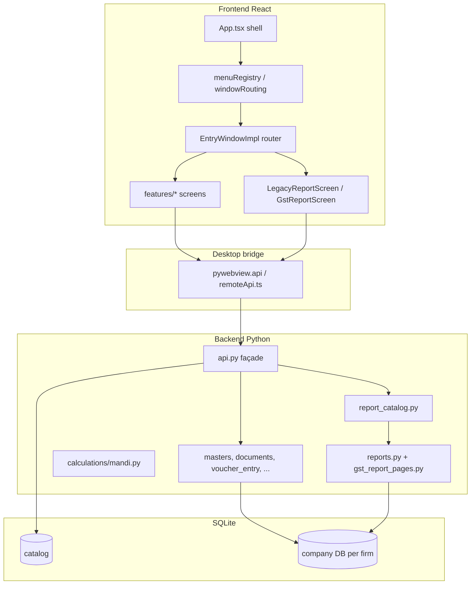

# Anaj ERP — Features, Architecture, Progress & Remaining Work

This document is a **living overview** for developers and stakeholders. For day-to-day “where is the code?” navigation, use [architecture/CODEMAP.md](architecture/CODEMAP.md). For **box diagrams (green / yellow / red)** of lifecycle, DB, autofill, and page dependencies, see [architecture/visual-system-map.md](architecture/visual-system-map.md). For competitive/modern desktop features, see [competitive-features.md](competitive-features.md).

**Last updated:** October 2026 (GST Reports menu UI + `gst_report_pages.py`).

---

## 1. Product summary

Anaj ERP is a **Windows desktop** grain/mandi accounting product:

- **UI:** React + TypeScript (Vite), keyboard-first legacy-style forms.
- **Runtime:** Python **pywebview** exposing RPC via `backend/anaj_erp/api.py`.
- **Data:** SQLite — one catalog DB + **one DB per company**; money in **paise**, quantities with explicit scale.
- **Default deployment:** **Standalone single PC**, multi-company on local disk ([standalone-mode.md](standalone-mode.md)). LAN/multi-user code is archived under `extra_code_Lan_Office/`.

---

## 2. Architecture (how pieces connect)

### 2.1 Frontend conventions

| Layer | Location | Role |
|--------|----------|------|
| Menu titles | `frontend/src/app/routing/menuRegistry.ts` | Hover submenus (Add/Modify, reports lists) |
| Title → component | `frontend/src/app/routing/windowRouting.ts` | Aliases for legacy names |
| Report keys | `frontend/src/app/routing/reportRegistry.ts` | Maps menu label → `report_key` |
| Window router | `frontend/src/features/legacy/EntryWindowImpl.tsx` | Picks feature screen, reports, tools, dense forms |
| Feature UI | `frontend/src/features/<name>/` | One folder per major screen ([MODULE_LAYOUT.md](architecture/MODULE_LAYOUT.md)) |
| Shared styling | `frontend/src/styles/accounts-entry.css` | Legacy report/entry look |

**Routing order matters:** GST report titles → `GstReportScreen`; other catalog reports → `LegacyReportScreen`; dense document types → `DenseDocumentForm` or dedicated entry screens.

### 2.2 Backend conventions

| Layer | Location | Role |
|--------|----------|------|
| RPC surface | `backend/anaj_erp/api.py` | Validated methods for UI; must stay in sync with `frontend/src/api/remoteApi.ts` |
| Posting engine | `backend/anaj_erp/documents.py`, `accounting.py` | Documents, vouchers, charges, stock |
| Domain entry modules | `*_entry.py` (lifting, mandi, GST, voucher, …) | Save/load/search for one form family |
| Reports | `report_catalog.py` → `reports.py` / **`gst_report_pages.py`** | Named `report_key` dispatch |
| Mandi math | `backend/anaj_erp/calculations/mandi.py` | Weights, fees, TCS/TDS rules |

### 2.3 Report pipeline (accounting + GST menus)

1. User sets filters on **LegacyReportScreen** or **GstReportScreen**.
2. UI calls `run_report(reportKey, params)`.
3. `ReportCatalog.run()` selects handler.
4. Handler returns `{ ok, rows, columns?, footer?, sections?, json? }`.
5. **Excel / Print:** `export_table` (CSV/PDF) with visible columns.

GST menu uses **schema-driven** filters: `frontend/src/features/gst-reports/gstReportSchemas.ts` + `GstReportScreen.tsx`.

---

## 3. What is implemented (by area)

### 3.1 Platform & accounting core

- Multi-company, April–March financial years, audited reversals (no hard delete of posted history).
- Double-entry vouchers, document posting with charges and stock movements.
- Effective-dated tax/charge snapshots on documents.
- Dense document engine for many voucher types (see [implementation-summary.md](implementation-summary.md)).

### 3.2 Masters

Dedicated feature screens (not only generic `MasterForms`) for Account, City, Transport, Trading Account, Item, Stock entry, Bank, IFSC, Expense, I-Form expense, Cheque print setting, Narration, etc. — see CODEMAP **Master menu** table.

### 3.3 Daily / transaction entry (modern split screens)

| Area | Status |
|------|--------|
| Lifting Entry | Dedicated feature + backend |
| Kachi Purchase | Dedicated feature + backend |
| Mandi Purchase Entry | Dedicated feature + backend |
| GST Purchase Entry | Dedicated feature + backend |
| Invoice (daily sale) | Dedicated feature + backend |
| GST Debit / Credit Note | Dedicated feature + backend |
| GST Expense Voucher | Dedicated feature + backend |
| Accounting Debit / Credit Note | Dedicated feature + backend |
| **Voucher Entry** (Receipt/Payment/Contra/Journal) | Dedicated feature + `voucher_entry.py` |
| **TDS Challan** Add/Modify | Dedicated feature + `tds_challan.py` |
| **Bank Reconciliation** | Dedicated feature + `bank_reconciliation.py` |

Legacy forms (Cash Book, Form-J, Form-I, etc.) still live in **`EntryWindowImpl.tsx`** / `DenseDocumentForm` where not yet extracted.

### 3.4 Search menu

| Screen | Status |
|--------|--------|
| Find Account | `search-screens/` + `search_screens.py` |
| Depreciation Chart | Same |
| Stock Adjustment Add/Modify | Same (`lines_json`, godown) |
| Company Letter Head Print | Same |

### 3.5 Reports menu (general)

- **LegacyReportScreen:** F3 View, Print, Excel, F4 Cancel; wired through `reportRegistry.ts` → `report_catalog.py`.
- Extended datasets: trial balance difference, group balances, cash in hand, trading + balance sheet bundles, interest variants (simple/compound), broker commission, item profitability, stock registers, pending bills, etc.

### 3.6 GST Reports menu (14 screens)

**UI:** Per-report filters, columns, and actions (View, Excel, Print where specified, JSON for GSTR-1 / Clause 44).

**Backend:** `gst_report_pages.py` formats display rows; filters in `gst_report_filters.py`; item/group lookups in `gst_reports.py`.

| # | Menu title | `report_key` | Notes |
|---|------------|--------------|--------|
| 1 | Purchase & Sale Summary | `gst_purchase_sale_summary` | Party + transaction type; footer totals |
| 2 | Bill Wise Sale Detail(GST) | `bill_wise_gst_sale` | B2B/B2C, GSTIN, line-level HSN |
| 3 | Month Wise Item Wise Sale Report | `month_item_wise_sale` | M/I, consolidate, group, exp, DN/CN toggles |
| 4 | Month Wise Item Wise Purchase Report | `month_item_wise_purchase` | Purchase columns |
| 5 | Gst Purchase Detail | `gst_purchase_detail` | Supplier, GSTIN, ITC eligibility |
| 6 | Form GSTR-1(Govt) | `gstr1_json` | Grid + JSON export payload |
| 7 | GST Debit/Credit Note Report | `gst_dn_cn_report` | Note type, party |
| 8 | HSN Wise Sale/Purchase Summary | `hsn_wise_summary` | Sale / Purchase / Both |
| 9 | Form GSTR-3B2 Fill | `gstr3b_summary` | Section rows 3.1, 3.2, 4.0, 5.0 |
| 10 | GSTR-2B Report Auto | `gstr2b_report` | Books-side purchase list + status filter |
| 11 | ITC Reversed & Claimed Report | `itc_reversed_report` | Action + reversal rule filters |
| 12 | ITC Availed Report (Capital Goods & Services) | `itc_availed_report` | Category filter |
| 13 | Report GSTR-9 | `gstr9_report` | Annual table sections 4–7 style |
| 14 | Clause 44 Tax Audit Export | `clause_44_tax_audit` | Expenditure summary row + JSON |

### 3.7 Tools, dashboard, integrations

See [competitive-features.md](competitive-features.md): WhatsApp share links, reminder PDFs, executive dashboard, bank CSV import, Clause 44, cover printing, blended cost, optional Google Drive backup, GSTIN lookup via API key, document attachments API.

### 3.8 Tests & dev workflow

- Pytest coverage for entry screens, search screens, report catalog, GST lookups, GST report page shapes (`tests/test_gst_report_pages.py`).
- Dev run: [cursor-rerun.md](cursor-rerun.md) → `tools/rerun_dev.ps1 -Agent`.
- Agent navigation rules: [AGENTS.md](../AGENTS.md), [CODEMAP.md](architecture/CODEMAP.md).

---

## 4. What is left / known gaps

### 4.1 GST & statutory depth (highest business risk)

These menus **render and export** with correct layouts but some **numbers depend on posted data quality** and a few aggregations are **simplified**:

| Gap | Detail |
|-----|--------|
| HSN-wise tax columns | IGST/CGST/SGST/Cess on HSN summary often **0** until charge amounts are allocated per HSN line in reports |
| GSTR-2B | **Offline books only** — no live GSTN 2B download; supplier GSTR-1 filing date blank; “Matched/Mismatched” is heuristic (GSTIN present vs missing) |
| GSTR-1 | JSON is a **starter B2B payload**; export/nil/HSN tables for portal filing need full gov schema |
| GSTR-3B / GSTR-9 | Section totals derived from **purchase/sale summary**, not full statutory classification |
| ITC reversed/claimed | Depends on **charge codes** (`ITC`, `ITC_REV`, etc.); reversal **rules 38/42/43/17(5)** need explicit metadata on documents |
| ITC availed (capital) | **Depreciation status** placeholder; category inferred from charge code text |
| Bill-wise sale taxes | Document-level CGST/SGST/IGST repeated on each line row (not line-apportioned) |
| Month-wise sale | Freight/expense column **0** unless tied to document freight/charges in query |
| Place of supply | Often **party state_code** only; not full POS rules |

**Recommended next steps:** enrich `document_charge` / line metadata at posting time; add integration module for 2B JSON import; golden-file tests against accountant Excel for one FY.

### 4.2 UI / parity with reference ERP

- [reference-erp-parity-matrix.md](reference-erp-parity-matrix.md) — not every legacy screen is pixel-perfect.
- [implementation-progress.md](implementation-progress.md) — field-by-field parity for all ~147 screens **not** claimed complete.
- Statutory **print layouts** (Haryana mandi) may need sign-off.
- Continue extracting monolith forms from **`EntryWindowImpl.tsx`** into `features/*`.

### 4.3 Pilot & release

- Accountant **golden files** and pilot sign-off ([accountant-pilot-signoff.md](accountant-pilot-signoff.md), [pilot-checklist.md](pilot-checklist.md)).
- **Code-signed installer** ([release-build-pipeline.md](release-build-pipeline.md)).
- Optional: WhatsApp Business API / SMTP (listed as future in competitive-features).

### 4.4 Architecture cleanup (non-blocking)

- Move more logic from `api.py` / monolithic services into `backend/anaj_erp/domains/` per MODULE_LAYOUT.
- Reduce duplicate party lookup RPCs (many `lookup_*_parties` methods) behind one parameterized search.
- Frontend: code-split large bundle (Vite chunk size warning).

### 4.5 LAN / multi-user

- Production LAN path is **archived**; restoring requires `extra_code_Lan_Office/` and separate ops doc.

---

## 5. How to extend safely

1. Read **CODEMAP** for the menu name → file paths.
2. **New menu window:** `windowCatalog.ts` + feature folder + `EntryWindowImpl` branch (or resolver) + backend RPC.
3. **New report:** `reportRegistry.ts` + `report_catalog.py` handler; GST menu also needs `gstReportSchemas.ts` + method in `gst_report_pages.py`.
4. **RPC rename:** update `api.py`, `remoteApi.ts`, and types together.
5. Do **not** load all of `EntryWindowImpl.tsx` unless the form is only defined there.

---

## 6. Related documents

| Document | Purpose |
|----------|---------|
| [architecture/CODEMAP.md](architecture/CODEMAP.md) | Menu → file paths |
| [architecture/MODULE_LAYOUT.md](architecture/MODULE_LAYOUT.md) | Folder conventions |
| [implementation-summary.md](implementation-summary.md) | Long feature list (foundation) |
| [implementation-progress.md](implementation-progress.md) | Phase 0–9 checklist |
| [competitive-features.md](competitive-features.md) | Modern/desktop differentiators |
| [calculation-spec.md](calculation-spec.md) | Mandi/GST calculation rules |
| [standalone-mode.md](standalone-mode.md) | Single-PC + backup |
| [AGENTS.md](../AGENTS.md) | Cursor agent scoped-work rules |

---

## 7. Quick “done vs left” checklist

| Area | Done | Left |
|------|------|------|
| Core accounting & SQLite model | Yes | Year-lock policies per customer |
| Split entry screens (GST, mandi, voucher, TDS, bank recon) | Yes | Remaining legacy forms in EntryWindowImpl |
| Search menu (4 screens) | Yes | — |
| General reports (LegacyReportScreen) | Mostly | Parity + more registers |
| GST Reports menu (14 UIs + columns) | Yes | Statutory accuracy, 2B import, HSN tax split |
| Tools / dashboard / WhatsApp links | Yes | Official WhatsApp API |
| Pilot / signed release | Partial | Golden files, installer signing |
| LAN multi-user | Archived | Optional restore from extra_code |

If you add a major feature, update **this file** (section 3 or 4) and the relevant row in **CODEMAP**.
